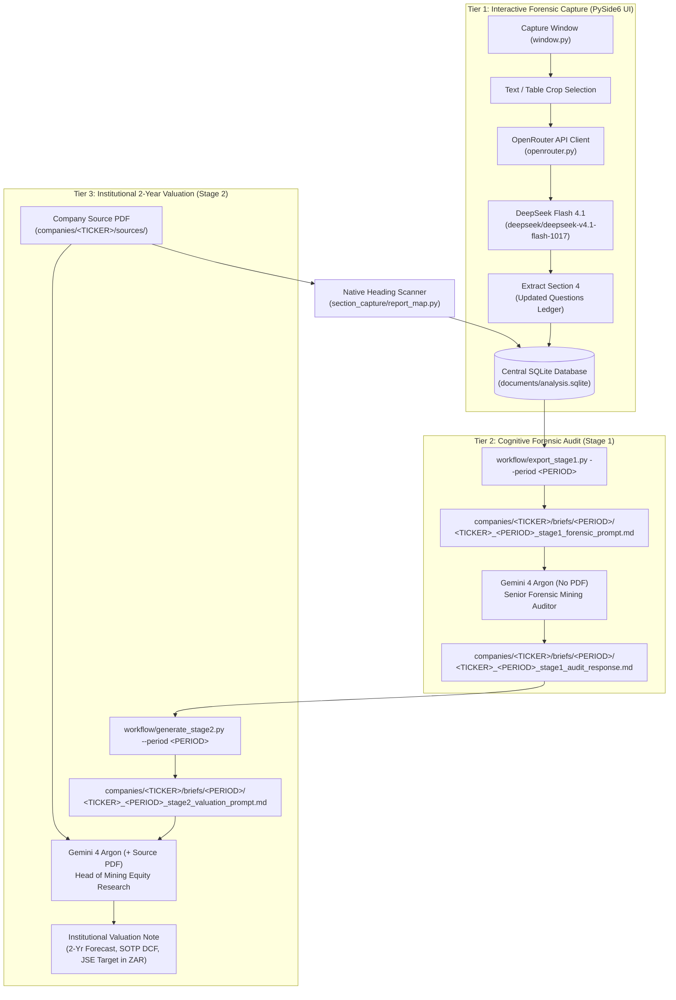

# System Architecture & Technical Specification

> **Purpose:** Comprehensive architectural blueprint, pipeline specifications, data contracts, and developer guidelines for the `stock_analysis_prompts` platform. This document serves as the onboarding and continuity foundation for both engineers and AI pair-programming agents.

---

## 1. Executive Summary & Core Objective

### 1.1 The Problem
Traditional LLM analysis of financial disclosures typically fails in two ways:
1. **Whole-PDF Hallucination & Loss of Precision:** Uploading a 50–100 page PDF into a generic prompt leads to dropped footnotes, missed unit-cost distortions, confused share counts, and superficial parroting of management narratives.
2. **Fragile Custom Modeling Scripts:** Writing bespoke, one-off financial projection scripts for every company report is labor-intensive, error-prone, and unsustainable for multi-company daily equity research.

### 1.2 The Solution: The Standardized 3-Tier Pipeline
This platform solves this by replacing manual script modeling with a **3-Tier Sequential Forensic Verification Architecture**:
1. **Tier 1 (Interactive Capture):** Fast, local PySide6 UI captures sections and executes **DeepSeek Flash 4.1** via OpenRouter API. Focuses on footnote deep-dives, arithmetic anomalies, and builds an evolving questions ledger in SQLite.
2. **Tier 2 (Cognitive Forensic Audit — Gemini 4 Argon):** Compiles all sequential extractions and questions ledgers from SQLite into a single markdown working paper (no PDF). Gemini 4 Argon acts as **Forensic Mining Accounting Auditor** to definitively resolve accounting junctions (share dilution, net debt/cash, EBITDA adjustments, AISC feedstock drag, capex forks, Section 36 mining tax).
3. **Tier 3 (Institutional Valuation & 2-Year Forecast — Gemini 4 Argon):** Combines the source PDF report with the audited Stage 1 determinations (acting as unshakeable ground truth). Gemini 4 Argon acts as **Head of Mining Equity Research** to generate the 2-year forecast, SOTP DCF, and final JSE target price in ZAR per share.

---

## 2. High-Level System Architecture



---

## 3. Component Deep-Dive

### 3.1 Tier 1: Local Capture & Rapid Scrutiny (`section_capture/`)
- **App Launcher:** `Run Capture.cmd` executes `python app.py`.
- **Canvas & Rendering (`section_capture/canvas.py`, `section_capture/pdf_source.py`):**
  - Renders physical PDF pages at custom DPI using `PySide6.QtPdf` / `pdfplumber`.
  - Coordinates are stored in native PDF points (`1/72 inch`, `[x0, top, x1, bottom]`).
  - Supports both exact text polygon selections and rectangular area crops.
- **OpenRouter Programmatic Dispatch (`section_capture/openrouter.py`):**
  - **In-Memory Credential Loading:** Loads `OPENROUTER_API_KEY` from `C:\Users\Dion\Desktop\Projects\EXTERNAL_TO_REPOS\credentials\secrets.env` (or environment). *Zero logging or terminal printing of keys is strictly enforced.*
  - **Model:** `deepseek/deepseek-v4.1-flash-1017` (fast, low-cost reasoning flash model).
  - **Asynchronous Execution:** Runs in a background `QThread` (`OpenRouterWorker`), preventing GUI freezing.
  - **Automated Ledger Continuity:** Upon completion, the response is stored in `sections.llm_response`, and Section 4 (`Updated Open Questions Ledger`) is parsed directly into `reports.questions_ledger` in SQLite, automatically feeding the subsequent section.
- **Diagnostic Tool (`test_openrouter_live.py`):**
  - Standalone script to test OpenRouter key detection, account quota/limits (`/api/v1/auth/key`), and completion latency.

### 3.2 Tier 2: Cognitive Forensic Audit (`workflow/export_stage1.py`)
- **Execution:** `python workflow/export_stage1.py <TICKER> --period <PERIOD>`
- **Mechanism:** Queries `documents/analysis.sqlite` for all sections belonging to the report's SHA-256. Packages the chronological text, tables, and evolving questions ledger into a single self-contained Markdown prompt.
- **Mandate for Gemini 4 Argon:** Acts as **Senior Forensic Mining Accounting Auditor**. No PDF is attached. It evaluates the working papers and independently reconciles the **7 Critical Forensic Junctions**:
  1. *Diluted Share Count & Emmerson CDI Date:* Solving the 2.0M share double-deduction mystery, verifying dividend ranking, and calculating pro-forma shares post-buyback.
  2. *Balance Sheet Cash vs Debt:* Reconciling gross DMTN debt, lease liabilities, short-term FVTPL money market funds, and net cash turnaround.
  3. *Share-Based Payments (SBP) in EBITDA:* Verifying whether cash-settled SBP was absorbed inside Adjusted EBITDA and determining true recurring operational EBITDA.
  4. *Third-Party Buy-In Feedstock AISC Distortions:* Quantifying the exact dollar-per-ounce unit cost distortion (+US$/oz) from low-margin buy-in material.
  5. *Underground Asset Economics:* Splitting premier high-grade platforms (e.g. Fairview MRC) from high-cost, cash-burning shafts (e.g. Sheba/Consort).
  6. *The Capex Fork:* Contrasting management's discretionary capital wish-list against the committed post-MTR technical sustaining capex cliff.
  7. *Section 36 Mining Tax Dynamics:* Modeling 100% upfront capex tax shields ($Y = 33 - 165/X$) and eliminating the fatal contradiction of modeling high growth capex with high cash tax.

### 3.3 Tier 3: Institutional 2-Year Valuation (`workflow/generate_stage2.py`)
- **Execution:** `python workflow/generate_stage2.py <TICKER> --period <PERIOD>`
- **Mechanism:** Reads the verified Stage 1 audit determinations (`<TICKER>_<PERIOD>_stage1_audit_response.md`) and compiles the Stage 2 prompt.
- **Mandate for Gemini 4 Argon:** Acts as **Head of Mining Equity Research**. Takes the attached full results PDF alongside the audited Stage 1 determinations as authoritative ground truth to formulate:
  - Asset-by-asset operational forecast (tonnes, grade, recovery, production, AISC).
  - Consolidated P&L, Adjusted EBITDA, Section 36 Cash Tax step-up, and FCFE.
  - Dual Capex Trajectory (Scenario A Expedited Growth vs. Scenario B Committed Capex Cliff).
  - Sum-of-the-Parts (SOTP) DCF model.
  - Definitive 12-Month JSE Target Price in **ZAR (Rands per share)**.

---

## 4. Multi-Company Workbench Directory Structure

All analytical assets are strictly consolidated under **`companies/<TICKER>/`**:

```
companies/
├── <TICKER>/
│   ├── sources/        # Original, read-only PDF reports (SHA-256 verified)
│   ├── research/       # External technical studies, tax memos, macro decks
│   ├── models/         # Valuation models, thin Jupyter sandbox (<ticker>_sandbox.ipynb)
│   └── briefs/         # Period-segregated audit briefs and valuation prompts
│       ├── FY26/
│       │   ├── <TICKER>_FY26_stage1_forensic_prompt.md
│       │   ├── <TICKER>_FY26_stage1_audit_response.md
│       │   └── <TICKER>_FY26_stage2_valuation_prompt.md
│       └── FY27/       # Subsequent reporting periods
```

### Scaffolding New Companies
To initialize a complete company hub with pre-wired models, directory structure, and Jupyter sandbox in one command:
```powershell
python new_company.py <TICKER> --name "<Full Company Name>"
```

---

## 5. Central SQLite Schema (`documents/analysis.sqlite`)

The database acts as the single source of truth for all section extractions, coordinates, and question ledgers:

### `reports` Table
Stores report-level metadata and global state, keyed by SHA-256:
- `sha256` (TEXT PRIMARY KEY): Unique hash of the source PDF.
- `filename` (TEXT): Base name of the PDF file.
- `original_path` (TEXT): Absolute path to the PDF in `companies/<TICKER>/sources/`.
- `byte_size` (INTEGER): File size in bytes.
- `physical_page_count` (INTEGER): Total physical pages in document.
- `report_map_json` (TEXT): JSON array of detected major sections (`D001`, `D002`, etc.).
- `questions_ledger` (TEXT): Active markdown text of the evolving Open Questions Ledger.
- `created_at` / `updated_at` (TEXT): ISO 8601 timestamps.

### `sections` Table
Stores granular immutable captures for each section:
- `id` (INTEGER PRIMARY KEY AUTOINCREMENT)
- `package_id` (TEXT UNIQUE): Unique UUID for the section package (`section-<hex>`).
- `report_sha256` (TEXT): Foreign key linking to `reports.sha256`.
- `section_number` (INTEGER): Sequential index (1, 2, 3...).
- `section_id` (TEXT): Heading section tag (e.g. `D002`, `D005.1`).
- `heading` / `subheading` (TEXT): Section titles.
- `analyst_question` (TEXT): Targeted query attached by the analyst.
- `selected_text` (TEXT): Plain text and Markdown tables extracted from PDF.
- `selections_json` (TEXT): Detailed polygon/bbox coordinates and metadata.
- `stored_questions_snapshot` (TEXT): State of questions ledger when this section was captured.
- `prompt` (TEXT): Assembled reading prompt sent to LLM.
- `llm_response` (TEXT): Stored response from DeepSeek Flash or other model.
- `manifest_json` (TEXT): Complete immutable section manifest.

---

## 6. Multi-Period Analysis (e.g., Transitioning to FY27)

When analyzing future periods for an existing company (e.g., PAN FY27):
1. **Drop PDF:** Place `Pan-African-Resources-2027.pdf` into `companies/PAN/sources/`.
2. **Open in Capture App:** The app detects the new SHA-256, initializes a fresh row in `reports`, and scans native headings without touching FY26 records.
3. **Carry-Forward Memory:** Seed the FY27 capture with the pending questions and unverified guidance from the FY26 Stage 1 & Stage 2 brief.
4. **Export Briefs:** Run `python workflow/export_stage1.py PAN --period FY27` to output into `companies/PAN/briefs/FY27/`.

---

## 7. Developer & Security Guidelines

### 7.1 Key Exposure Rules
- **ZERO KEY LOGGING:** Never print, log, echo, or write API keys (`OPENROUTER_API_KEY`) to terminal outputs, artifacts, or code commits.
- Keys must always be loaded dynamically in memory from `C:\Users\Dion\Desktop\Projects\EXTERNAL_TO_REPOS\credentials\secrets.env`.

### 7.2 Testing & Quality Gates
- Use local uv `.venv` (`.venv/Scripts/python.exe`).
- Test execution command:
  ```powershell
  .venv/Scripts/python.exe -m pytest tests -q -p no:cacheprovider --basetemp=tmp/<unique-task>
  ```
- **Requirements:**
  - Always report actual exit codes (e.g., Exit Code `0`).
  - Always ensure test-created Qt windows and application instances are cleanly disposed.
  - Clean up temporary directories (`tmp/<unique-task>`) immediately after test completion.

### 7.3 Currency Standard
- Mining equities listed on the JSE (e.g., PAN, HAR) must always report per-share metrics, price targets, and equity research valuations in **ZAR (Rands per share or ZAR cents)**, accompanied by USD conversions where relevant.
