# Native PDF Table Extraction Pilot: Gemini Independent Evidence Audit

**Evaluator:** Gemini (Google Antigravity IDE)  
**Evaluator Model & Settings:** Gemini 3.8 Flash (High)  
**Evaluation Timestamps:** UTC: `2026-10-28T18:43:06Z` | Local (Africa/Johannesburg): `2026-10-28T20:43:06+02:00`  
**Evaluated Pilot Directory:** [`companies/consumer_lending/NTU/briefs/1H26/evaluations/20261028T182010Z_native_extraction_pilot`](file:///c:/Users/diond/Desktop/Projects/stock_analysis_prompts/companies/consumer_lending/NTU/briefs/1H26/evaluations/20261028T182010Z_native_extraction_pilot)  
**Audit Save Location:** [`companies/consumer_lending/NTU/briefs/1H26/evaluations/20261028T184306Z_gemini/audit.md`](file:///c:/Users/diond/Desktop/Projects/stock_analysis_prompts/companies/consumer_lending/NTU/briefs/1H26/evaluations/20261028T184306Z_gemini/audit.md)  
**Audit Decision:** **EXTRACTION IMPROVEMENTS SUPPORTED WITHIN SAMPLE; CORRECTIONS REQUIRED FOR PERSISTENT MODEL SIGN, CLOSURE, AND COLUMN-OVERLAP DEFECTS**  
**Evaluation Scope:** Isolated Tier 1 section-reading pilot (5 selected captures across NTU 1H26 and PAN FY26). No Stage 1 synthesis, Stage 2 forecasting, or valuation requested or performed. Cost and timing comparisons are non-controlled engineering diagnostics, not scientific benchmarks.

---

## 1. Operating Protocol & Framework Alignment

This independent evaluation is conducted strictly pursuant to:
1. `AGENTS.md` (Continuity & Evidence Rules: Gemini independently reviews DeepSeek, Codex reviews Gemini, no paid OpenRouter API calls or production database modifications during review).
2. `workflow/STATE.md` and `workflow/WORKFLOW.md` (Native PDF table extraction pilot verification, Fireworks-only provider constraints, validated delta progression).
3. `docs/STOCK_EVALUATION_FORMAT.md` Section 1A (Mandatory independent evaluation record, SHA-256 checksum verification, claim verification register, reproducible calculations).
4. [`workflow/changes/20261028_table_extraction/gemini_prompt.md`](file:///c:/Users/diond/Desktop/Projects/stock_analysis_prompts/workflow/changes/20261028_table_extraction/gemini_prompt.md) instructions.

---

## 2. Evidence Preservation & Source Verification

### 2.1 Primary Source Document Checksums
Primary source PDFs were verified directly from disk via SHA-256 before analysis:
- **NTU 1H26 Interim Financial Statements:**  
  Path: `companies/consumer_lending/NTU/sources/completed/1H26/nutunlimitedcondensedconsolidatedafs31march2026.pdf`  
  SHA-256: `9a19b3b40ca26781100da0f0bd7d59a870fabd253a66ccac0c9926f14bc4fbbc` (Matches `plan.json` and production database).  
  Physical Pages Examined: **13, 21, 22, 23, 24, 25** (1-indexed).  
  Unexamined Remainder: Pages 1–12, 14–20, 26–38 (`NOT VERIFIED`).
- **PAN FY26 Results SENS Announcement:**  
  Path: `companies/mining/PAN/sources/Pan-African-Resources-year-end-results-SENS-announcement-2026.pdf`  
  SHA-256: `62b10bcd8e6216c00bbe005ae85a3c3341e01e82fd24af0516de18bf69c9b4dd` (Matches `plan.json` and production database).  
  Physical Pages Examined: **48, 49, 50** (1-indexed).  
  Unexamined Remainder: Pages 1–47, 51–54 (`NOT VERIFIED`).

### 2.2 Production SQLite Database Integrity
All 9 tables in `documents/analysis.sqlite` were snapped using canonical table representation hashing and verified 100% byte-for-byte identical to `plan.json`:
- `app_state`: `9bcd0a193181aac196979f31be6f23df1b2aafc452823904b84dc42264a83516` (Match)
- `ledger_events`: `4f53cda18c2baa0c0354bb5f9a3ecbe5ed12ab4d8e11ba873c2f11161202b945` (Match)
- `ledger_questions`: `4f53cda18c2baa0c0354bb5f9a3ecbe5ed12ab4d8e11ba873c2f11161202b945` (Match)
- `market_quotes`: `17605ec17424da0bef37be745222267af1fa405f83f4cda681c6c9367b407418` (Match)
- `reports`: `5d8a9ee23c34dbd7bba03238968beac20366e91cd776c0b2e39c3f4d3d96d126` (Match)
- `section_response_attempts`: `4f53cda18c2baa0c0354bb5f9a3ecbe5ed12ab4d8e11ba873c2f11161202b945` (Match)
- `sections`: `7660f65780687d24c6cde635819b097754b32edf9043c41779b001f0cf269188` (Match)
- `sector_guardrails`: `10f1a34eba623b531840905ced0006d3c2a80c8184817ea6c876df4274886484` (Match)
- `sqlite_sequence`: `4b136b46db36397f485f1b85f97a126a329505136686bb4c99ec03a0b99ef501` (Match)

### 2.3 Preserved Input Manifest
All 39 evaluated pilot files (plans, metrics, Codex audit, validations, raw outputs, baseline responses, prompt templates, and input states) are immutably copied into [`inputs/`](file:///c:/Users/diond/Desktop/Projects/stock_analysis_prompts/companies/consumer_lending/NTU/briefs/1H26/evaluations/20261028T184306Z_gemini/inputs/) with complete checksums stored in [`inputs/manifest.json`](file:///c:/Users/diond/Desktop/Projects/stock_analysis_prompts/companies/consumer_lending/NTU/briefs/1H26/evaluations/20261028T184306Z_gemini/inputs/manifest.json).

---

## 3. Claim Verification Register

The complete claim register is saved in [`claims.json`](file:///c:/Users/diond/Desktop/Projects/stock_analysis_prompts/companies/consumer_lending/NTU/briefs/1H26/evaluations/20261028T184306Z_gemini/claims.json). Key claims evaluated against primary source evidence include:

| Claim ID | Claim Statement & Origin | Classification | Primary Evidence | Independent Verification & Method | Verdict | Consequence & Linked Finding |
| :--- | :--- | :--- | :--- | :--- | :---: | :--- |
| **C001** | Native extraction separates NTU p. 22 cells 5 and 390; carrying value foots to 5 + 390 + 3,845 + 644 = 4,884 Rm, resolving false 9,879 Rm allegation. | Table extraction / Arithmetic | NTU physical p. 22 Note 6.1 | Recomputed: 5 + 390 + 3845 + 644 = 4884 exact (residual 0). Prior baseline merged '5' and '390' into '5 390' (5390 + 3845 + 644 = 9879). | **PASS** | Confirmed extraction fix eliminates false R4,995m asset inflation allegation. ([`F001`](#f001---supported-within-sample-p22-column-separation-eliminates-false-r4995m-asset-inflation)) |
| **C002** | Native extraction correctly maps comparative closing FX dates on NTU p. 25 (USD 17.2 / 18.4 / 17.3; GBP 22.7 / 23.9 / 23.2 to Mar-26 / Mar-25 / Sep-25). | Comparative period mapping | NTU physical p. 25 Note 6.2 | Direct PDF audit: Col 4 is 31 Mar 26, Col 5 is 31 Mar 25, Col 6 is 30 Sep 25. New answer assigns exact dates without date swap. | **PASS** | Eliminates comparative closing rate swap present in baseline. ([`F002`](#f002---supported-within-sample-p25-comparative-fx-closing-rate-mapping-corrected)) |
| **C003** | Preserving prose outside markdown tables on NTU p. 13 and short literal anchors enable 5/5 valid ledger deltas without validator failures; rolls foot exactly. | Pipeline validation / Arithmetic | NTU physical p. 13 Note 1, 1.1, 1.2 | Recomputed: 3975 + 382 - 728 + 383 - 167 = 3845; 702 + 28 - 116 + 30 = 644; total 4489. All 5 deltas valid (`errors: []`). | **PASS** | Validates that clean prose extraction + literal anchors resolve delta rejections. ([`F003`](#f003---supported-within-sample-p13-prose-preservation--literal-anchors-yield-55-valid-deltas)) |
| **C004** | DeepSeek persists in calling the R167m impairment loss on NTU p. 24 an "impairment release" and questioning the "sustainability of that release". | Accounting sign interpretation | NTU physical p. 24 Note 6.1 | Net movement is -241 + 69 + 4 + 1 = -167 (loss). Because POCI allowance is a cumulative gain, movement from 598 to 431 is an impairment loss (-167 Rm in P&L), not a release. | **FAIL** | Model inverts economic reality, treating a credit loss charge as positive income. ([`F004`](#f004---corrections-required-p24-poci-impairment-loss-mischaracterized-as-an-impairment-release)) |
| **C005** | DeepSeek prematurely resolves Q-08aa5c3f257440ab while explicitly acknowledging that the total R4,489m PBD carrying value was not reconciled in this capture. | Ledger semantic closure | inputs/ntu_assets.json; outputs/ntu_assets.md | Closure condition required reconciliation to carrying value. Model admitted R4,489m scope was unverified and deferred to a new question, but set status to 'resolved'. | **FAIL** | Premature question closure in persistent ledger; status should remain partial. ([`F005`](#f005---corrections-required-premature-resolution-of-q-08aa5c3f257440ab)) |
| **C006** | PAN FY25 Gold production reconciles to 196,527 oz across disjoint components (92,643 + 2,654 + 98,636 + 1,081 + 1,513); model double-counts 1,081 oz using 93,724. | Column scope selection / Double counting | PAN physical pp. 48-49 | Executed reconciliations.py: disjoint sum foots to 196527 exact. Model took 93724 (which already contains 1081 buy-in) and added 1081 again, yielding 197608 (+1081 oz gap). | **FAIL** | Model creates false +1,081 oz discrepancy against issuer due to buy-in double-counting. ([`F006`](#f006---corrections-required-pan-fy25-gold-production-double-counting-of-1081-oz-buy-in)) |
| **C007** | Multi-tier grouped headers on PAN pp. 48-49 are flattened into a single row, obscuring the hierarchy between Mining, Surface, and Total operations. | Layout extraction limitation | PAN physical pp. 48-49; after/PAN_48.md | Inspected markdown: Columns 4-6, 7-11, 12-16 are concatenated without hierarchical grouping, leading to model column misattribution. | **PASS** | Confirms fundamental Markdown table limitation; layout uncertainty should be carried. ([`F007`](#f007---architectural-limitation-flattened-multi-tier-headers-in-markdown)) |
| **C008** | DeepSeek claims Tennant FY25 A$ all-in cost (A$1,584,835/kg) is a "likely printing/scale error" and flags a ~53 US$/oz AISC conversion residual. | Speculative model inference | PAN physical pp. 48-50 | Tennant surface feedstock in FY25 produced only 1,513 oz (47 kg) in initial commissioning; initial setup capex divided by 47 kg naturally yields extreme unit cost. Group AISC uses asset weights. | **FAIL** | Unsubstantiated model speculations alleging issuer errors without evidence. ([`F008`](#f008---corrections-required-speculative-claims-of-source-errors-in-pan-dense-table)) |
| **C009** | PAN source PDF exhibits genuine 1-ounce subtotal rounding differences and an internal 5,763 oz MTR column variance between surface operations and total operations. | Primary source document anomaly | PAN physical pp. 48-49 | Recomputed: FY26 1-oz differences (105,479 vs 105,478; 118,852 vs 118,853; 272,311 vs 272,310). MTR FY25 tailings: Col 6 is 25043, Col 14 is 30806 (diff 5763 oz = FY26 MTR buy-in). | **PASS** | Confirms genuine source integer rounding and reveals an internal issuer table inconsistency. ([`F009`](#f009---primary-evidence-fact-genuine-1-ounce-rounding-and-mtr-5763-oz-internal-column-variance)) |

---

## 4. Forensic Verification of Required Analytical Points

### 4.1 NTU Financial Assets Carrying Value: 5 + 390 + 3,845 + 644 = 4,884 Rm
- **Primary Source Evidence:** Note 6.1 (physical p. 22), table titled *"Financial assets subject to risk"*, sub-table *"31 March 2026 – Unaudited"*.
  - Column 1: `Other loans and receivable` = R5m
  - Column 2: `Trade and other receivables*` = R390m (Gross R395m less R5m non-performing allowance)
  - Column 3: `Principal book portfolio` = R3,845m (Gross R3,414m plus R431m POCI impairment gain)
  - Column 4: `Other financial assets` = R644m
  - Column 5: `Total` = R4,884m
- **Forensic Check:**  
  $$5 + 390 + 3,845 + 644 = 4,884 \text{ Rm (Exact)}$$
- **Baseline Defect vs Native Extraction Fix:**  
  In the baseline extraction, the small width of the first column caused the characters `5` and `390` to merge into a single text segment `"5 390"`. DeepSeek evaluated this as R5,390m and summed $5,390 + 3,845 + 644 = 9,879 \text{ Rm}$, alleging a catastrophic R4,995m asset inflation discrepancy against Nutun management.  
  In the pilot extraction, the introduction of native vertical rule detection (`crop.edges` where orientation is `'v'`) and numeric row column anchoring cleanly segregated the columns. DeepSeek read 5, 390, 3,845, and 644 separately, verified the 4,884 Rm total, and completely retracted the false asset inflation claim.

### 4.2 NTU Portfolio Headings & Signed -167 Loss versus Impairment Release
- **Primary Source Evidence:** Note 6.1 (physical p. 24), table titled *"Reconciliation of expected credit loss allowance on principal book portfolios"*.
  - Balance at 30 September 2025: R598m
  - Impairment (loss)/gain on principal book portfolios: -R167m
    - Banking & specialised lending – Unsecured: -R241m (Acquired +R1m, Historical -R242m)
    - Debt review: +R69m (Acquired +R23m, Historical +R46m)
    - Retail: +R4m (Historical +R4m)
    - Banking – Secured: +R1m (Historical +R1m)
  - Balance at 31 March 2026: R431m
- **Forensic Check:**  
  $$\text{Movement: } -241 + 69 + 4 + 1 = -167 \text{ Rm}$$  
  $$\text{Vintage: } (1 + 23) + (-242 + 46 + 4 + 1) = 24 - 191 = -167 \text{ Rm}$$  
  $$\text{Balance: } 598 - 167 = 431 \text{ Rm}$$
- **Persistent Model Accounting Error:**  
  Note 1 (p. 13) and Note 6.1 (p. 21) establish that purchased book debts are POCI financial assets. POCI assets carry a **cumulative lifetime impairment gain** as a positive add-back to gross carrying value (representing collections expected above the deep-discount purchase price).  
  Therefore, a downward movement from R598m to R431m is an **impairment loss of R167m** (a debit charge against profit/loss).  
  In `outputs/ntu_headers.md`, DeepSeek repeatedly refers to this movement as an *"impairment loss of 167 (release)"*, discusses *"total release 167"*, and raises a question regarding the *"sustainability of ECL release"*. This inverts the economic and accounting reality: an impairment loss is a profit drag resulting from credit deterioration on historical books (payer drop-offs), not an earnings-boosting release of excess reserves. This remains an active model failure requiring prompt-level guardrail reinforcement.

### 4.3 NTU Comparative Closing Foreign Exchange Rates
- **Primary Source Evidence:** Note 6.2 (physical p. 25), table titled *"Significant exchange rates applied during the period"*.
  - Reporting date closing rates:
    - 31 March 2026: USD 17.2 | GBP 22.7 | EUR 19.7 | AUD 11.8
    - 31 March 2025: USD 18.4 | GBP 23.9 | EUR 20.0 | AUD 11.6
    - 30 September 2025: USD 17.3 | GBP 23.2 | EUR 20.3 | AUD 11.4
- **Baseline Defect vs Native Extraction Fix:**  
  In the baseline extraction, wide multi-column headers swallowed intermediate column boundaries, resulting in cells being shifted into incorrect columns. DeepSeek inverted the comparative closing rates, assigning USD 18.4 / GBP 23.9 to 30 Sep 2025 and USD 17.3 / GBP 23.2 to 31 Mar 2025.  
  In `outputs/ntu_fx.md`, the native extraction correctly assigned USD 17.2/18.4/17.3 and GBP 22.7/23.9/23.2 to Mar-26, Mar-25, and Sep-25 respectively.

### 4.4 NTU Prose Evidence Anchors & Valid Delta Execution
- **Primary Source Evidence:** Note 1 (physical p. 13).
  - Contains 3 long narrative paragraphs defining POCI amortised cost and FVTPL titleless contracts, followed by two separate roll-forward tables (Principal book 3,845 Rm; Other financial assets 644 Rm; Total 4,489 Rm).
- **Extraction & Prompt Fix:**  
  Previously, the PDF extractor placed entire prose paragraphs inside Markdown table rows, wrapping each line with pipe characters (`|`). When DeepSeek attempted to cite exact sentences in the ledger delta, whitespace and pipe mismatches caused strict quote validator rejections.  
  The updated extractor (`section_capture/pdf_source.py`) detects non-tabular prose spans and running headers, rendering them as standard Markdown paragraphs outside the table environment. Furthermore, `section_capture/question_ledger.py` was updated to instruct the model to provide **short literal anchors (8–50 characters)** from a single cell or sentence.  
  As a result, all 5 pilot cases produced valid deltas (`ledger_valid: true`, 0 errors), confirming that prose preservation and short anchor instructions eliminate quote-matching brittleness without weakening validation rigor.

### 4.5 POCI Applicability & Q-08aa5c3f257440ab Premature Closure
- **Incoming Question Condition (`inputs/ntu_assets.json`):**  
  *"PBD measurement basis and applicable ECL model stated and reconciled to the carrying value, or confirmed not disclosed... Forecast consequence: credit-loss treatment, amortisation projection and earnings volatility."*
- **Model Output & Evaluation:**  
  In `outputs/ntu_assets.md`, DeepSeek correctly established the POCI accounting framework (measured at amortised cost with credit-adjusted EIR 19.2%; favourable changes recognized as impairment gains; generic Stage 1/2 contractual cash flow ECL inapplicable).  
  However, DeepSeek explicitly stated:  
  *"The R4,489m carrying value referenced in the question is not visible in this capture; scope reconciliation carried to a new question."*  
  Despite deferring the carrying-value reconciliation to a new question, DeepSeek marked `Q-08aa5c3f257440ab` as **`"status": "resolved"`**.  
  This violates the explicit closure condition, which required both the measurement basis *and* the reconciliation to the carrying value. Valid evidence anchors locate disclosures; they do not satisfy closure conditions. The status should have remained `partial`.

---

### 4.6 PAN Operations Scope Reconciliation & FY25 Double-Count
- **Primary Source Evidence:** PAN FY26 Results SENS (physical pp. 48–49), *"Group Production Summary"*.
  - Disjoint production lines:
    1. Gold produced – underground (Mining operations): Barberton 65,895 oz + Evander 26,748 oz = **92,643 oz**
    2. Gold production – surface operations (Mining operations): Barberton = **2,654 oz**
    3. Gold produced – tailings (Surface operations): BTRP 15,224 oz + Elikhulu 52,606 oz + MTR 30,806 oz = **98,636 oz**
    4. Gold produced – third-party buy-in feedstock: Evander = **1,081 oz**
    5. Gold produced – surface feedstock: Tennant Mines = **1,513 oz**
- **Independent Reconciliation Check:**  
  $$92,643 + 2,654 + 98,636 + 1,081 + 1,513 = \mathbf{196,527 \text{ oz (Exact)}}$$  
  Matches printed Group Total gold produced of **196,527 oz** with **zero residual**.
- **DeepSeek Column Selection & Double-Count Error:**  
  Under the *Total operations* block, the table provides an "Evander Mines total" underground figure of 27,829 oz (which incorporates 26,748 underground + 1,081 buy-in), and a "Group total" underground figure of **93,724 oz** ($92,643 + 1,081 = 93,724$).  
  In `outputs/pan_dense.md` Section 2 and Question 3, DeepSeek calculated:  
  $$93,724 + 2,654 + 98,636 + 1,081 + 1,513 = \mathbf{197,608 \text{ oz}}$$  
  DeepSeek noted the 1,081 oz residual against printed 196,527 oz, and even noted in parentheses that $27,829 - 26,748 = 1,081 \text{ oz}$ represents the buy-in feedstock. Yet, it failed to realize that using 93,724 oz meant the 1,081 oz buy-in was already counted, and then added the 1,081 oz line a second time! This is a classic model column-selection overlap error, not a company reporting error.

### 4.7 PAN Grouping Labels, 1-Ounce Subtotals, Unit Conversions & Source Inconsistencies
- **Hierarchical Grouping Labels:**  
  The PAN production table spans 16 columns across 3 tiers: Major Operation (`Mining operations`, `Surface operations`, `Total operations`), Asset (`Barberton`, `Evander`, `BTRP`, `Elikhulu`, `MTR`, `Tennant`), and Scope (`Total`, `total`). Because Markdown lacks multi-level header syntax, these tiers are flattened into a single row, creating ambiguity between asset-level underground mining and consolidated totals.
- **Genuine Source 1-Ounce Subtotal Differences:**  
  Independent inspection of the primary PDF confirms three genuine 1-ounce subtotal discrepancies due to integer rounding in the published report:
  1. FY26 Underground Mining components: $65,233 + 40,246 = 105,479 \text{ oz}$ vs printed Group total of **105,478 oz** (-1 oz).
  2. FY26 Total Mining components: $71,997 + 46,855 = 118,852 \text{ oz}$ vs printed Mining Total of **118,853 oz** (+1 oz).
  3. FY26 Group Total: Mining Total 118,853 + Surface Total 153,458 = **272,311 oz** vs printed Group Total of **272,310 oz** (-1 oz).
- **Internal Source Table Inconsistency (MTR Tailings Variance):**  
  In the FY25 tailings row (p. 48), Column 6 (`Surface operations MTR operation`) prints **25,043 oz**, whereas Column 14 (`Total operations MTR operation total`) prints **30,806 oz** (a variance of **5,763 oz**).  
  The printed Surface operations subtotal of **98,636 oz** foots using the Column 14 figure ($15,224 + 52,606 + 30,806 = 98,636$), whereas using Column 6 gives 92,873 oz (leaving 5,763 oz unexplained). Remarkably, **5,763 oz** is the exact third-party buy-in feedstock volume processed at MTR in FY26! This indicates an internal drafting or column population inconsistency in Pan African Resources' published SENS announcement.
- **Speculative Source Error Claims:**  
  DeepSeek claimed that Tennant FY25 A$ all-in cost (A$1,584,835/kg) is a *"likely printing/scale error"* and that the ZAR/kg to US$/oz conversion difference represents an unexplained residual (~53 US$/oz).  
  These claims are unverified:
  1. Tennant surface feedstock produced only 1,513 oz (47.06 kg) during FY25 pre-commissioning. Upfront commissioning capital and site overheads divided by a diminutive 47 kg denominator mathematically produce an extreme unit rate.
  2. Group AISC translates asset costs at transaction-date FX rates and sales-weighted volumes, not a crude arithmetic annual average FX rate ($985,551 \div 16.90 \div 32.1507 = 1,814$).

---

## 5. Architectural Assessment: Extraction Fix vs Layout Uncertainty

A core instruction of this review is to assess whether remaining extraction defects warrant further programmatic changes or should be carried as analytical uncertainty.

### 5.1 Programmatic Scope & Boundaries
- The implemented changes in `section_capture/pdf_source.py` (native vertical edge separation, numeric row column anchoring, wide-heading suppression, and prose layout preservation) are **generic, compact, and highly effective**. They resolved catastrophic cell merging (NTU Note 6.1) and column inversions (NTU Note 6.2) without introducing company-specific rules or dependencies.
- However, complex multi-tier table structures (such as PAN pp. 48–49) contain 3-tier hierarchical headers spanning variable column spans (`colspan`). In standard GitHub Flavored Markdown (GFM), table headers are strictly single-line, flat column lists. GFM cannot represent nested column spans.
- Attempting complex table reconstruction (e.g. attempting to parse visual line hierarchies, merge spanning headers, or synthesize nested Markdown tables) across arbitrary corporate PDF layouts is notoriously brittle, prone to endless regex patches, and contrary to the repository principle of avoiding bespoke modeling code.

### 5.2 Architectural Recommendation
- **Do NOT implement complex table reconstruction or company-specific extraction rules.**
- Carry source layout limitations (such as flattened multi-tier headers) as **documented analytical uncertainty**.
- Address column selection and overlap risks at the prompt level: reinforce analytical guidelines instructing the model to verify whether a candidate total column already incorporates secondary feedstock rows before aggregating.

---

## 6. Synthesis: Implemented Fixes, Benefits, Errors & Proposals

```mermaid
flowchart TD
    subgraph Implemented_Fixes["Implemented Native Extraction Fixes"]
        E1["Native vertical rule detection (crop.edges)"]
        E2["Numeric-row column anchoring"]
        E3["Prose paragraph preservation outside tables"]
        E4["Short literal anchor prompt guidance (8-50 chars)"]
    end

    subgraph Demonstrated_Benefits["Demonstrated Benefits"]
        B1["NTU p.22 5 and 390 separate (4,884 exact; 9,879 eliminated)"]
        B2["NTU p.25 Comparative FX closing dates correctly mapped"]
        B3["5/5 Valid ledger deltas without delimiter stripping"]
        B4["PAN p.48 Dense tailings cells properly segmented"]
    end

    subgraph Remaining_Model_Errors["Remaining DeepSeek Model Deficiencies"]
        M1["NTU p.24 -167 loss misclassified as impairment release"]
        M2["NTU p.22 Q-08aa5c3f257440ab resolved prematurely"]
        M3["PAN p.48 FY25 1,081 oz buy-in double-counted using 93,724"]
        M4["PAN p.49 Speculative printing error claims on Tennant unit costs"]
    end

    subgraph Evaluation_Findings["Gemini Independent Forensic Findings"]
        G1["PAN source PDF exhibits genuine 1-oz subtotal rounding differences"]
        G2["PAN MTR FY25 tailings has internal 5,763 oz source variance"]
        G3["Carry multi-tier layout limitations as uncertainty (no complex table parser)"]
    end

    Implemented_Fixes --> Demonstrated_Benefits
    Demonstrated_Benefits -.-> Remaining_Model_Errors
    Remaining_Model_Errors --> Evaluation_Findings
```

### 6.1 Implemented Fixes
1. Native vertical edge detection (`crop.edges`, orientation `'v'`, length $\ge 10$) to separate proximate numeric cells.
2. Numeric-row column anchoring based on rows containing $\ge 2$ numeric cells, preventing wide headers from creating spurious columns.
3. Wide-heading column swallowing suppression and non-tabular prose span preservation outside Markdown tables.
4. Prompt-level instruction for short literal anchors (8–50 characters) preserving numbers and signs.

### 6.2 Demonstrated Benefits
1. Complete elimination of false R4,995m asset inflation allegation on NTU Note 6.1 ($5 + 390 + 3,845 + 644 = 4,884 \text{ Rm}$).
2. Accurate comparative period mapping for NTU Note 6.2 closing exchange rates (USD 17.2/18.4/17.3; GBP 22.7/23.9/23.2).
3. 100% valid ledger delta execution (5/5 cases valid) with zero repair loops or validator softening.
4. Clean separation of dense numerical figures in PAN mining and tailings summary tables.

### 6.3 Remaining DeepSeek Errors
1. Inverted accounting sign interpretation on NTU Note 6.1: treating a R167m reduction in cumulative impairment gain as an "impairment release".
2. Premature semantic closure of ledger question `Q-08aa5c3f257440ab` while deferring essential carrying-value reconciliation.
3. Double-counting 1,081 oz buy-in feedstock in PAN FY25 gold production by combining `Group total` underground (93,724) with buy-in (1,081).
4. Speculative assertions of issuer printing errors on Tennant FY25 unit costs and AISC conversion conventions.

### 6.4 Evaluator Omissions in Previous Audits
- In the initial Codex audit (`audit.md`), the disjoint sum for PAN FY25 was correctly stated as $92,643 + 2,654 + 98,636 + 1,081 + 1,513 = 196,527 \text{ oz}$. However, Codex did not identify the internal source inconsistency in the PAN tailings table: Column 6 prints 25,043 oz while Column 14 prints 30,806 oz, with the printed subtotal of 98,636 oz silently incorporating the 30,806 oz figure (a 5,763 oz variance corresponding exactly to FY26 MTR buy-in).

---

## 7. Institutional Recommendation for Next Minimal Step

**Recommendation (Do Not Implement):**
1. **Approve and retain the generic native extraction changes** in `section_capture/pdf_source.py` and `section_capture/question_ledger.py`. They have demonstrated clear benefits in eliminating false asset inflation and table corruption without regressions across the 232-test offline suite.
2. **Do not attempt complex multi-tier table reconstruction.** Carry flattened grouped headers as a documented source layout limitation.
3. **Formulate a minimal prompt clarification for consumer lending & mining reading briefs:**
   - In `consumer_lending` sector notes: explicitly state that for POCI assets where allowances represent cumulative impairment gains, downward allowance movements are **impairment losses (P&L charges)**, not allowance releases.
   - In general reading briefs: explicitly instruct models that when calculating production or revenue totals from multi-column tables, verify whether candidate total/subtotal columns already aggregate secondary feedstock/product lines before adding them together.
   - In ledger closure instructions: strictly forbid setting a question to `resolved` if any sub-clause of the closure condition (such as carrying value tie-out) remains open or is deferred to a new question.
4. **Authorize a full chronological section-by-section trial** on NTU 1H26 using the refined extractor and updated guidance to measure full ledger convergence.
