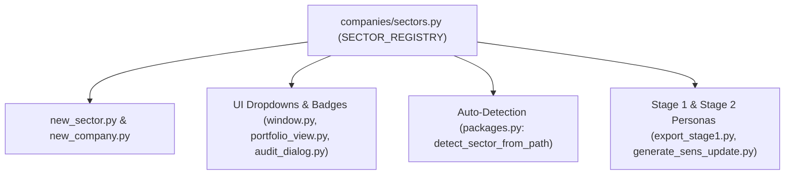

# Sector Onboarding Standard Operating Procedure (SOP)

This document provides definitive, end-to-end instructions for onboarding a new industry sector into the equity research workbench in under **2 minutes**.

---

## 1. Architecture Overview

Sector metadata is fully centralized in [`companies/sectors.py`](file:///c:/Users/Dion/Desktop/Projects/stock_analysis_prompts/companies/sectors.py).
All UI components, detection routines, export pipelines, and portfolio dashboards dynamically consume this registry:



---

## 2. Fast-Track Protocol (2-Minute Workflow)

When the user requests a new sector (e.g. `healthcare`, `industrials`, `banking`, `energy`):

### Step 1: Run Sector Scaffolding CLI (30 Seconds)
Execute `new_sector.py` with the canonical lowercase code, full title, and short badge label:

```powershell
.venv/Scripts/python.exe new_sector.py <code_name> --name "<Full Display Name>" --short "<Short Label>" --aliases <alias1> <alias2>
```

*Example:*
```powershell
.venv/Scripts/python.exe new_sector.py healthcare --name "Healthcare & Pharmaceuticals" --short "Healthcare" --aliases pharma medical health
```

This single command automatically:
1. Registers `SectorConfig` into [`companies/sectors.py`](file:///c:/Users/Dion/Desktop/Projects/stock_analysis_prompts/companies/sectors.py) with an auto-assigned distinct badge color palette.
2. Initializes the company directory tree at `companies/<code_name>/__init__.py`.
3. Scaffolds [`prompts/<code_name>/00-report-orientation/v1.0.0/prompt.md`](file:///c:/Users/Dion/Desktop/Projects/stock_analysis_prompts/prompts/).
4. Scaffolds [`prompts/<code_name>/12-analyst-reading-brief/v1.1.0/prompt.md`](file:///c:/Users/Dion/Desktop/Projects/stock_analysis_prompts/prompts/).
5. Dynamically exposes the sector across all PySide6 UI dropdowns, badges, and filters.

---

### Step 2: Tailor the Sector Forensic Reading Brief (60 Seconds)
Open [`prompts/<code_name>/12-analyst-reading-brief/v1.1.0/prompt.md`](file:///c:/Users/Dion/Desktop/Projects/stock_analysis_prompts/prompts/) and tailor Section 2 to include 3–5 sector-specific accounting and forensic focus areas.

#### Sector Reference Cheatsheet:
| Sector | Key Forensic Junctions & Accounting Focus Areas |
| :--- | :--- |
| **Healthcare & Pharma** | Patent expiry cliffs, Phase II/III clinical trial milestones, IAS 38 R&D capitalization vs expensing, regulatory pricing approvals (SEP), distributor working capital. |
| **Industrials & Engineering** | Order book / backlog burn rate, percentage-of-completion accounting, raw material price escalation pass-through, warranty provisions, fixed vs variable cost operating leverage. |
| **Banking & Financial Services** | Net Interest Margin (NIM), Stage 3 ECL coverage ratio, non-performing loans (NPLs), CET1 regulatory capital adequacy, credit loss ratio, fee vs interest revenue mix. |
| **Energy & Petrochemicals** | Refining crack spreads, feedstock hedging derivative accounting, turnaround maintenance capex, environmental decommissioning provisions, carbon tax liability. |
| **Food & Agriculture** | Biological asset fair value adjustments (IAS 41), soft commodity hedge accounting, cold chain logistics costs, livestock/harvest cycles, export parity pricing. |

*Always ensure Section 5 retains the mandatory negative constraints:*
> "Respond in pure plain text only. Do not use unclosed HTML tags (`<br>`, `<span>`). Use `<br/>` for line breaks within table cells. Output the Updated Open Questions Ledger in clean Markdown bullet format."

---

### Step 3: Scaffold Company Hub (15 Seconds)
Scaffold the target company under the newly created sector:

```powershell
.venv/Scripts/python.exe new_company.py <TICKER> --sector <code_name> --name "<Full Company Name>"
```

*Note on Ticker Detection:*
- If the company ticker has an alias (e.g. `IOC` vs `IOCO`, or legacy name `EOH`), register the mapping in:
  1. `candidates` list in [`companies/__init__.py`](file:///c:/Users/Dion/Desktop/Projects/stock_analysis_prompts/companies/__init__.py).
  2. `KNOWN_COMPANIES` in [`section_capture/db.py`](file:///c:/Users/Dion/Desktop/Projects/stock_analysis_prompts/section_capture/db.py).

---

### Step 4: Targeted Verification (15 Seconds)
Do **not** run the entire 93+ test suite iteratively during development. Run the fast targeted sector tests:

```powershell
.venv/Scripts/python.exe -m pytest tests/test_sectors.py tests/test_capture.py -k sector -q -p no:cacheprovider --basetemp=tmp/pytest-quick
Remove-Item -Recurse -Force tmp/pytest-quick -ErrorAction SilentlyContinue
```

Once green, run the full test suite once before user handoff:
```powershell
.venv/Scripts/python.exe -m pytest tests -q -p no:cacheprovider --basetemp=tmp/pytest-final
Remove-Item -Recurse -Force tmp/pytest-final -ErrorAction SilentlyContinue
```

---

## 3. Anti-Patterns & Trip-Up Safeguards

1. **Avoid Hardcoded Sector Lists**:
   - Never hardcode sector strings (`["mining", "retail", ...]`) in new UI files or dialogs.
   - Always import and call `get_all_sectors()`, `get_sector_display()`, or `get_sector_badge_style()` from `companies.sectors`.

2. **Regex Substring Collisions**:
   - Company ticker matching must never use naive substring tests like `ticker in path_str` (which caused `comPANies` to falsely match `PAN`).
   - Ticker detection must always prioritize structural directory parts (`companies/<sector>/<ticker>`) and use strict word boundaries (`\b<TICKER>\b`).

3. **Background Pytest Cleanups**:
   - Never run `Remove-Item tmp/...` concurrently with an active background test process. Wait for the background task to complete before removing the directory to avoid Windows file lock errors (`PermissionError`).
